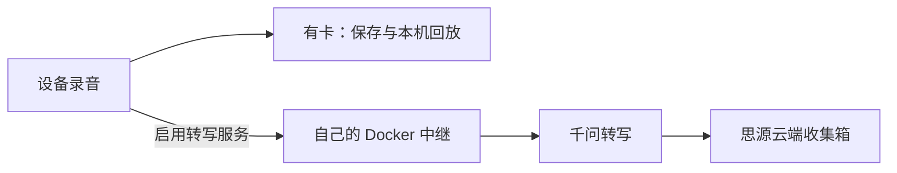

# 拾想 · IdeaPickup

**随手录下想法，离线留在卡上；需要时转成文字，送进自己的思源收集箱。**

IdeaPickup 是运行在 ESP32-S3 语音设备上的录音工具，配套可自行部署的 Docker 转写中继。可以只把它当离线录音机，也可以接上千问和思源，让录音自动变成笔记。

- **有卡离线录放**：不连 Wi-Fi、不部署服务，也能录音、浏览和回放。
- **联网自动转写**：中继部署在自己的电脑或服务器上，千问负责转写，文字进入思源云端收集箱。
- **无卡联网托底**：没插卡也能向中继分块上传录音，查看处理结果；无卡记录不能回放。
- **触摸和本地语音操作**：触摸录音、停止和回放，或用“你好喵伴”唤醒后发出录音指令；16 MB 喵伴还可用作 USB 麦克风。
- **浏览器配置**：手机连接设备热点后手动打开配网页，查看真实联网／配对状态；密钥只在后端管理页填写。

**当前下载：[2026.10.27-rc1 预发布](https://github.com/dahuang53/IdeaPickup/releases/tag/2026.10.27-rc1)**，含两板固件、源码和配套双架构镜像。这是有已知限制的预发布；完整低电矩阵未验证，斑梨有一项未解决的看门狗告警，详见[支持与限制](docs/SUPPORT.md#known-limits)。

## 选择你的使用方式

| 想做什么 | 需要准备 | 按这个顺序操作 |
|---|---|---|
| 只录音和回放 | 支持的设备、microSD 卡、可传数据的 USB 线 | [下载固件](docs/PUBLIC_RELEASE.md) → [安装](docs/DEVICE_INSTALL.md) → 保持“仅本地使用” → [录放](docs/SUPPORT.md#daily-use) |
| 在家里用电脑转写 | 上述设备、运行 Docker 的电脑、同一路由器的 2.4 GHz Wi-Fi、千问和思源云端凭据 | [本地 Docker 部署](docs/DEPLOYMENT.md#local-docker) → [后台配置](docs/DEPLOYMENT.md#admin-setup) → [刷机和配对](docs/DEVICE_INSTALL.md#pairing) |
| 使用自己的服务器转写 | 支持的设备、Docker 服务器、域名与可信 HTTPS、千问和思源云端凭据 | [服务器部署](docs/DEPLOYMENT.md#server-https) → [后台配置](docs/DEPLOYMENT.md#admin-setup) → [刷机和配对](docs/DEVICE_INSTALL.md#pairing) |

本地电脑部署直接填写**电脑的内网 IP**，默认端口 8765，不需要域名。服务器部署填写 **HTTPS 服务地址**。管理后台是该服务地址加上 `/admin/`：地址由部署者先确定，**无需先登录后台才能知道它**。示例和找 IP 的方法见[地址对照表](docs/DEPLOYMENT.md#addresses)。

联网转写需要千问 API 的可用额度，以及可使用思源云端收集箱的账号；获取方式见[凭据准备](docs/DEPLOYMENT.md#provider-setup)。本地部署指中继在本地，千问和思源仍需联网；目前没有离线转写或本地思源内核接口。

## 支持的硬件

| 设备 | 固件目标 | 存储规格 | USB 麦克风 |
|---|---|---|---|
| ESP-VoCat V1.2 喵伴 | `vocat16` | **16 MB QIO** | 支持 |
| ESP32-S3-Touch-LCD-1.28-BOX 斑梨 | `spotpear` | **16 MB DIO** | 不支持 |

**32 MB 喵伴和其他板型暂不支持。** 同为 ESP32-S3 不表示固件通用；请先核对实物，再下载对应包。首次安装使用项目的受保护刷写脚本，写入前备份原 Flash；普通更新只写应用，详见[安装与更新](docs/DEVICE_INSTALL.md)。

## 开始使用与遇到问题

| 要找的内容 | 入口 |
|---|---|
| 下载哪个附件、核对 SHA256、选哪个镜像 | [版本与下载](docs/PUBLIC_RELEASE.md) |
| Docker 启动、后台 URL、初始化、密钥、配对码 | [部署与后台配置](docs/DEPLOYMENT.md) |
| 首次刷机、下载模式、手机配网、设备配对 | [设备安装与配置](docs/DEVICE_INSTALL.md) |
| 录放、无卡模式、USB 麦克风、记录状态 | [日常使用](docs/SUPPORT.md#daily-use) |
| 打不开页面、配对失败、没有转写结果、存储问题 | [故障排查](docs/SUPPORT.md#troubleshooting) |
| 已验证范围和已知风险 | [支持与限制](docs/SUPPORT.md#known-limits) |
| 后端和固件普通更新 | [后端更新](docs/DEPLOYMENT.md#updates)、[固件更新](docs/DEVICE_INSTALL.md#updates) |
| 报告问题 | [提交前准备](docs/SUPPORT.md#reporting)、[安全问题](SECURITY.md) |

有卡音频保存在自己的 SD 卡。启用转写服务时，新录音自动处理一次；未处理的旧有卡录音可在详情手动提交，处理中可以取消。请先确认录音适合交给自己的中继和千问。中继不提供音频库或云端回放：成功或拒绝后清理暂存音频，失败／中断的闲置暂存最长 24 小时；投递完成清理暂存正文。详见[数据与重试](docs/SUPPORT.md#data-and-status)。

## 开发与许可

直接使用发布附件不需要编译固件。开发环境、锁定依赖、构建与测试命令见[开发说明](CONTRIBUTING.md)、[测试入口](docs/TESTING.md)和[后端说明](server-relay/README.md)。

项目原创代码采用 [Apache-2.0](LICENSE)。第三方代码、动画、字体、模型和提示音各自保留原许可，见[第三方声明](THIRD_PARTY_NOTICES.md)。不要在公开 Issue 中上传 API Key、设备令牌、原始日志、录音或数据库。
